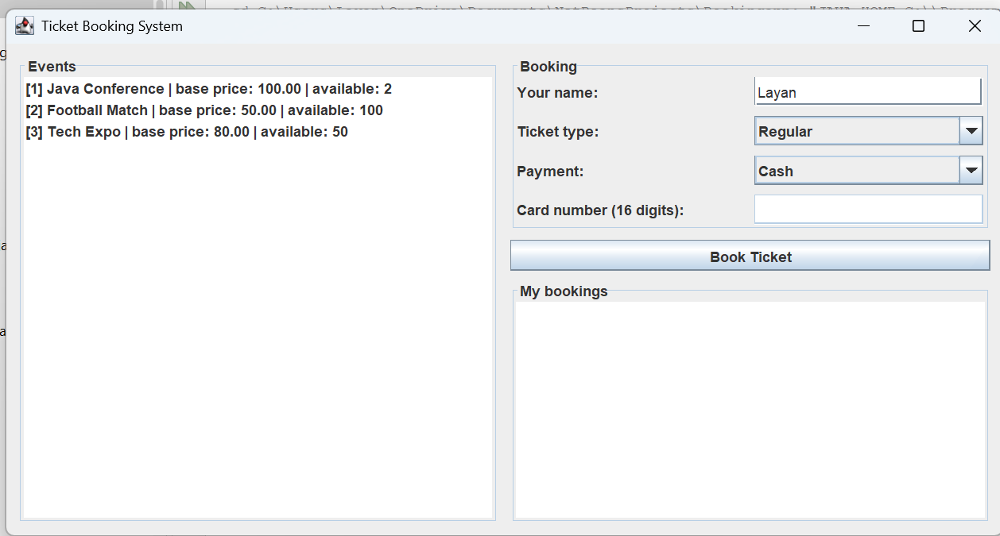

# Ticket Booking System

Java OOP application for booking event tickets, with a Swing GUI.

## Features
- Browse events and book Regular or VIP tickets
- Cash and card payment
- Seat availability tracking and error handling

## Concepts Used
Inheritance, Abstraction, Polymorphism, Interfaces, Exception Handling,
Collections, Singleton and Factory patterns, Java Swing

## Tech
Java, Maven, NetBeans

## Run
Open in NetBeans and run `BookingGUI.java`.

## Screenshots
